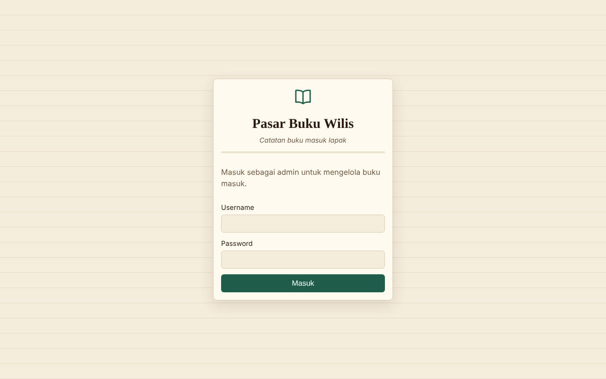
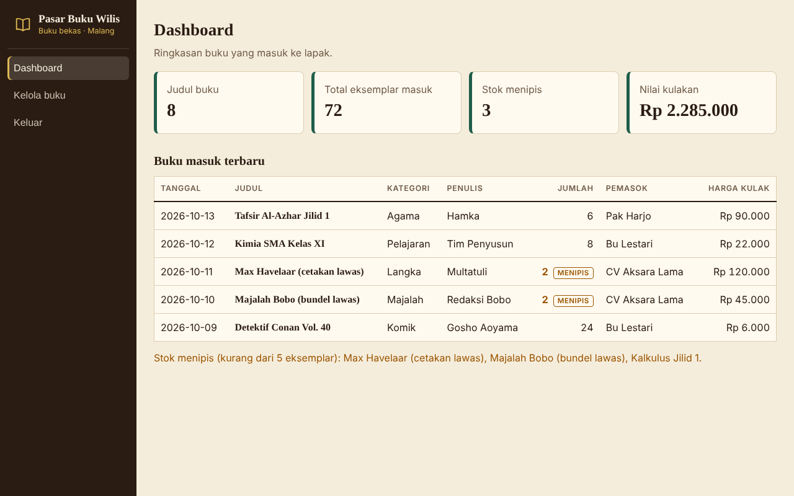
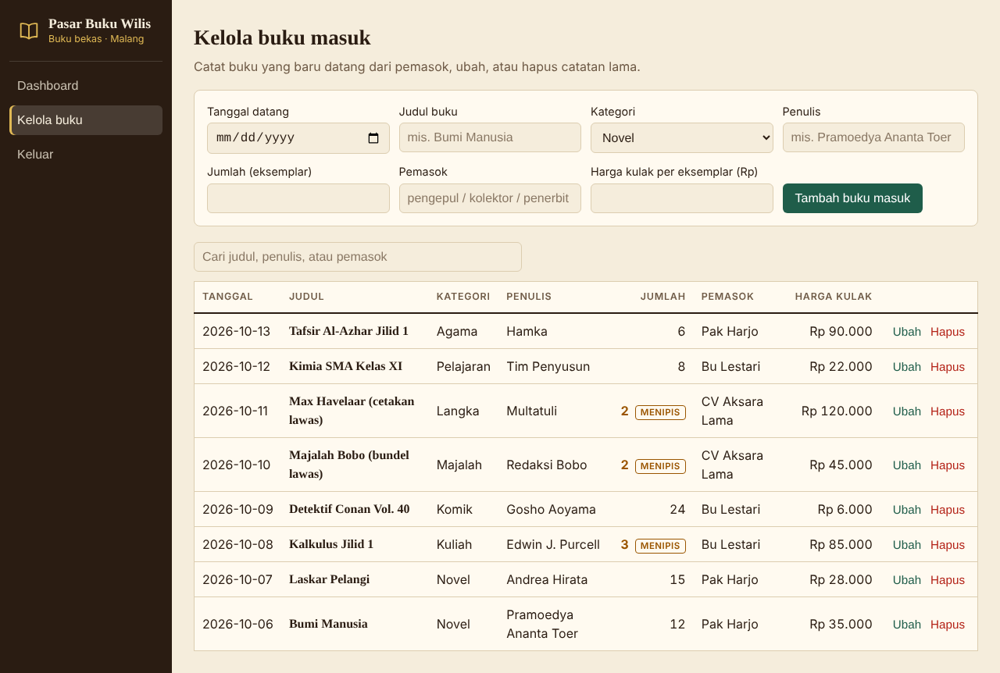

# Pasar Buku Wilis

Prototipe sistem pencatatan **buku masuk untuk lapak buku bekas di Pasar Buku Wilis, Malang**: judul apa saja yang datang dari pemasok (pengepul, kolektor, atau penerbit), berapa eksemplarnya, dan stok mana yang menipis.

| Antarmuka | Pengguna | Teknologi |
|---|---|---|
| Backend API (`backend/`) | Web & Mobile | Express + MySQL (REST) |
| Dashboard Web (`web/`) | Admin / pemilik lapak | React + Vite |
| Mobile App (`mobile/`) | Pengunjung pasar | Flutter |

## Fitur
**Web:** login simulasi, dashboard (kartu ringkasan + tabel buku masuk terbaru), halaman Kelola buku (tambah, ubah, hapus, cari), peringatan stok menipis (< 5 eksemplar). Data diperbarui otomatis tiap 5 detik, jadi input dari mobile langsung muncul.
**Mobile:** alur layar *Splash Screen -> Masuk -> Daftar -> Beranda*, lalu 6 tab: **Beranda** (sambutan, pencarian, kategori pilihan, temuan istimewa), **Kategori** (tema buku, filter kondisi, daftar lorong), **Denah** (denah kios yang bisa dipilih & di-zoom, detail kios, fasilitas), **Forum** (postingan pengunjung/pedagang, suka, buat postingan), **Tentang** (sejarah, lokasi, fasilitas, FAQ), dan **Akun** (profil singkat & keluar). Tampilan mengikuti desain yang diberikan; data masih contoh (`lib/data/dummy_data.dart`). `lib/api.dart` (klien REST ke backend) tetap ada untuk disambungkan nanti.
**Validasi:** judul buku wajib, penulis wajib, jumlah bilangan bulat > 0, harga tidak negatif, tanggal wajib, password minimal 6 karakter (mobile). Aturan yang sama juga diperiksa ulang di backend.
**Data:** satu database MySQL (`pasar_buku_wilis`, tabel `buku`) yang dipakai bersama oleh web dan mobile lewat REST API.

**Kategori buku:** Novel, Komik, Pelajaran, Kuliah, Agama, Anak, Majalah, Langka, Lainnya.

## Cara menjalankan
Urutan: **MySQL -> Backend -> Web / Mobile**.

### 1. MySQL
Nyalakan MySQL (XAMPP / Laragon: Start MySQL). Database, tabel, dan 8 data contoh dibuat otomatis saat backend pertama kali jalan, tidak perlu impor manual (`backend/schema.sql` hanya referensi).

> Database lama `hexacore_sparepart` (kalau ada) tidak dipakai lagi dan tidak otomatis dihapus. Database baru `pasar_buku_wilis` dibuat terpisah.

### 2. Backend
```bash
cd backend
npm install
npm start
```
Default koneksi: host `127.0.0.1`, user `root`, tanpa password (cocok untuk XAMPP/Laragon). Kalau MySQL kamu beda, salin `.env.example` jadi `.env` lalu sesuaikan. Cek di browser: http://localhost:3000/buku

### 3. Web
```bash
cd web
npm install
npm run dev
```
Buka http://localhost:5173. Login: **admin / admin123**. Alamat API bisa diubah lewat `VITE_API_URL` (opsional).

### 4. Mobile
```bash
cd mobile
flutter pub get
flutter run -d chrome
```
Login simulasi: email valid + kata sandi minimal 6 karakter (atau tombol Google / Akun Kios untuk langsung masuk). Layar Daftar juga simulasi.
- Emulator Android: alamat API otomatis `http://10.0.2.2:3000`.
- HP asli (satu WiFi dengan laptop): `flutter run --dart-define=API_URL=http://IP-LAPTOP:3000`

## API
| Method | Endpoint | Fungsi |
|---|---|---|
| GET | `/buku` | Daftar semua buku masuk (terbaru di atas) |
| GET | `/buku/:id` | Satu data |
| POST | `/buku` | Tambah buku masuk |
| PUT | `/buku/:id` | Ubah data |
| DELETE | `/buku/:id` | Hapus data |

Body POST/PUT: `tanggal` (YYYY-MM-DD), `judul`, `kategori`, `penulis`, `jumlah` (eksemplar), `pemasok`, `harga` (harga kulak per eksemplar, Rp). Gagal validasi -> HTTP 400 dengan pesan `message`.

## Library / package
- Backend: `express`, `mysql2`, `cors`, `dotenv`
- Web: `react`, `react-dom`, `vite`, `@vitejs/plugin-react`
- Mobile: `flutter` (Material 3), `http`; font Playfair Display & Plus Jakarta Sans disertakan di `mobile/assets/fonts` (tanpa internet)

## Rancangan fitur AI (pengembangan berikutnya)
**Prediksi kulakan.** Sistem membaca riwayat buku masuk dan buku terjual tiap judul, lalu memperkirakan kapan stok habis dan menyarankan judul serta jumlah yang perlu dikulak lagi. Contoh: "Kalkulus Jilid 1 diperkirakan habis dalam 7 hari, disarankan kulak 10 eksemplar".
- **Input:** riwayat transaksi per judul, kategori, musim ramai (mis. tahun ajaran baru, masa UTS/UAS, penerimaan mahasiswa baru, menjelang Ramadan untuk buku agama).
- **Pendekatan:** model time-series sederhana (moving average / regresi), dapat ditingkatkan ke model machine learning.
- **Output:** daftar rekomendasi pada Dashboard Web dan notifikasi di Mobile App.
- **Status:** belum diimplementasikan; hanya rancangan.

## Screenshot
### Mobile


### Web Dashboard




