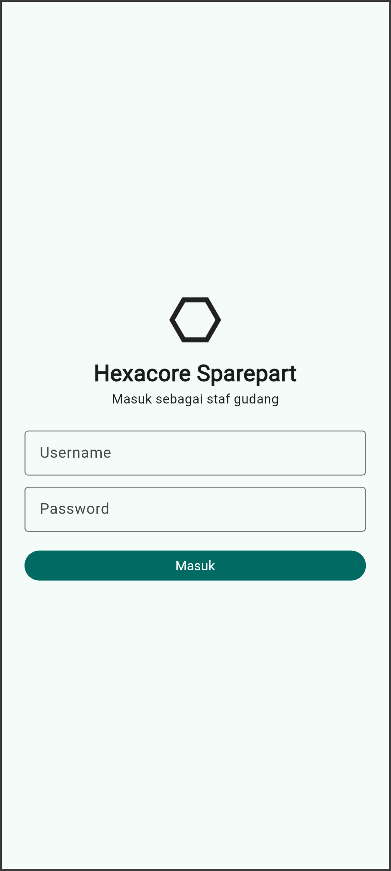
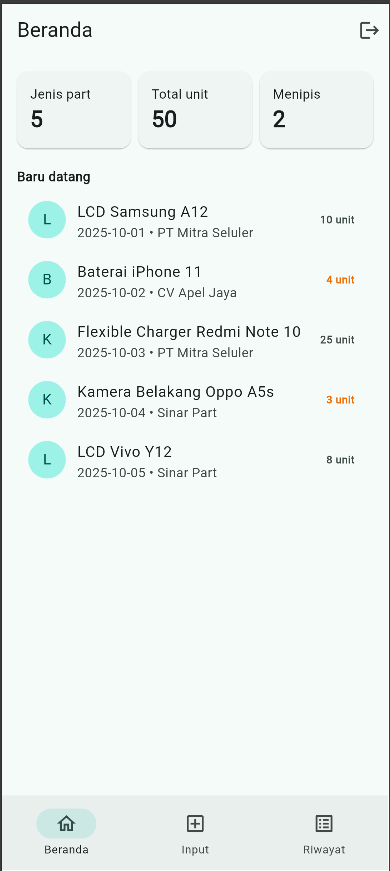
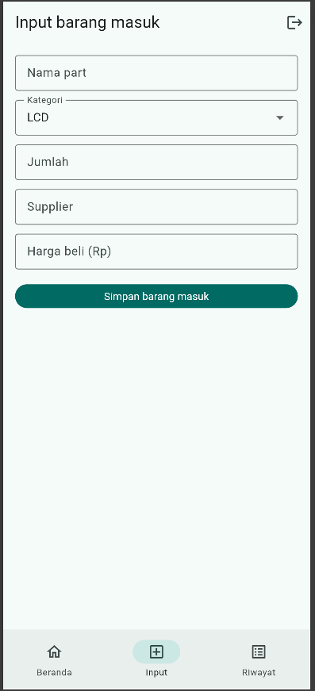
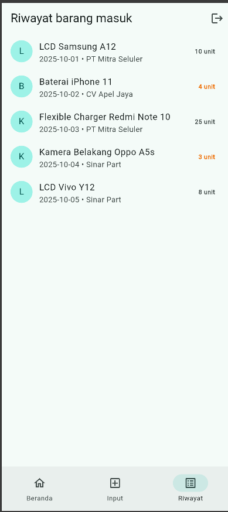
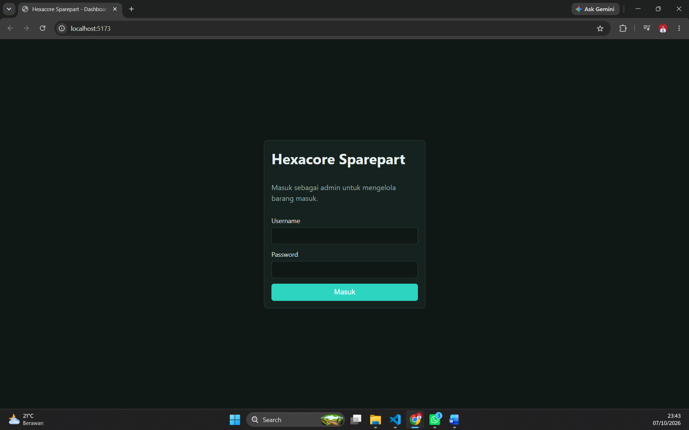
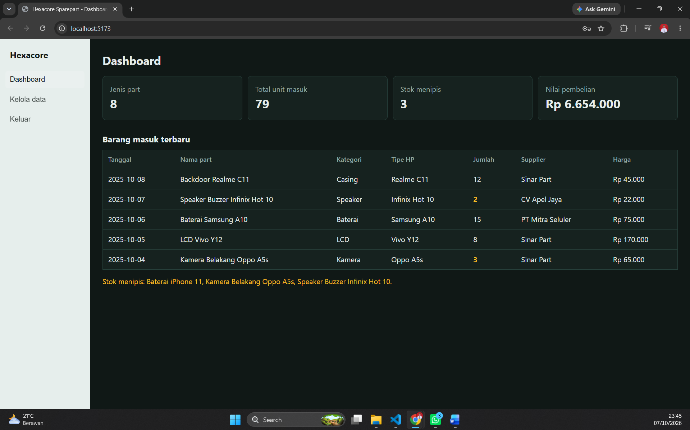
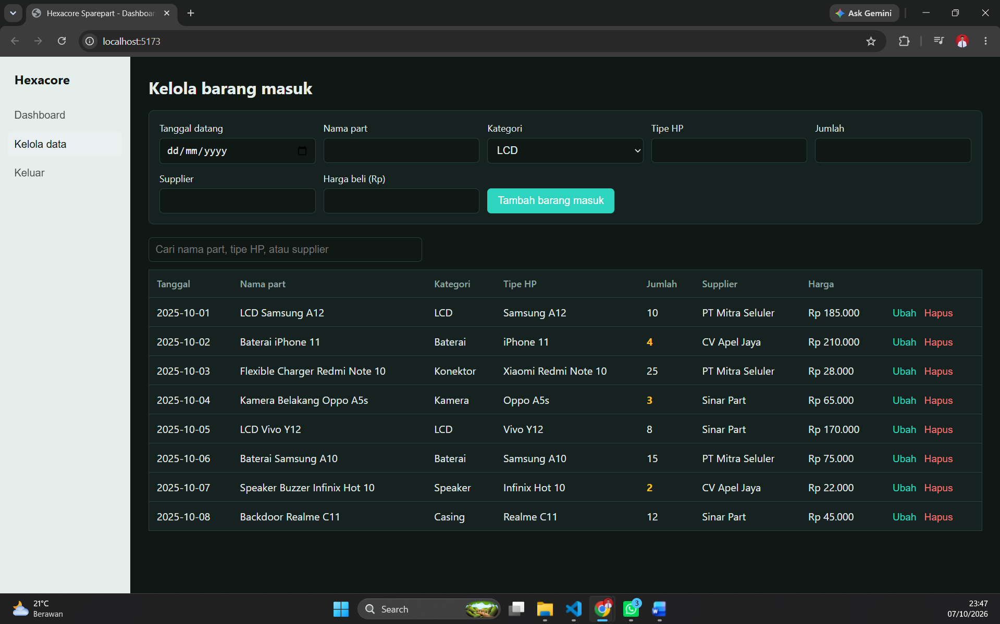

# Hexacore Sparepart

Prototipe sistem pencatatan **barang masuk sparepart HP**: part apa saja yang datang dari supplier, berapa jumlahnya, dan stok mana yang menipis.

| Antarmuka | Pengguna | Teknologi |
|---|---|---|
| Dashboard Web (`web/`) | Admin / pemilik toko | React + Vite |
| Mobile App (`mobile/`) | Staf gudang | Flutter |

## Fitur
**Web:** login simulasi, dashboard (kartu ringkasan + tabel barang masuk terbaru), halaman Kelola data (tambah, ubah, hapus, cari), peringatan stok menipis (< 5 unit).
**Mobile:** login simulasi, beranda (kartu ringkasan + barang baru datang), form input barang masuk, riwayat barang masuk.
**Validasi:** nama part wajib, jumlah > 0, harga tidak negatif, tanggal wajib (web), password minimal 6 karakter (mobile).
**Data:** mock JSON (`web/src/data.js`) + `localStorage` di web; dummy data di memori pada mobile. Tanpa database.

## Cara menjalankan

### Web
```bash
cd web
npm install
npm run dev
```
Buka alamat yang tampil di terminal (biasanya http://localhost:5173). Login: **admin / admin123**.

### Mobile
```bash
cd mobile
flutter create .      # sekali saja, membuat folder android/ios
flutter pub get
flutter run
```
Login simulasi: username bebas, password minimal 6 karakter.

## Library / package
- Web: `react`, `react-dom`, `vite`, `@vitejs/plugin-react`
- Mobile: `flutter` (Material 3), tanpa package tambahan

## Rancangan fitur AI (pengembangan berikutnya)
**Prediksi restock.** Sistem membaca riwayat barang masuk dan barang keluar (penjualan/servis) tiap part, lalu memperkirakan kapan stok habis dan menyarankan part serta jumlah yang perlu dipesan. Contoh: "LCD Oppo A5s diperkirakan habis dalam 7 hari, disarankan pesan 10 unit".
- **Input:** riwayat transaksi per part, tipe HP, musim ramai (mis. menjelang libur).
- **Pendekatan:** model time-series sederhana (moving average / regresi), dapat ditingkatkan ke model machine learning.
- **Output:** daftar rekomendasi pada Dashboard Web dan notifikasi di Mobile App.
- **Status:** belum diimplementasikan; hanya rancangan.

## Screenshot
### Mobile






### Web Dashboard



